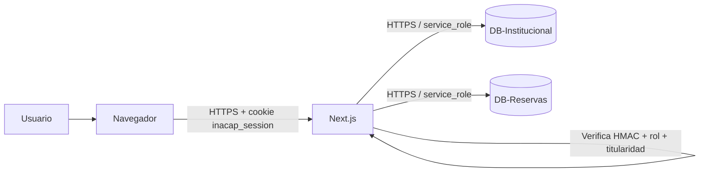

# Corrección de seguridad — 10 puntos

**Proyecto:** Sistema de Reservas Institucional  
**Stack:** Next.js 14 · TypeScript · Supabase (PostgreSQL + PostgREST)  
**Fecha:** 6 de noviembre de 2026

---

## 1. Resumen ejecutivo

Se corrigieron los diez puntos de seguridad identificados. La aplicación pasó de un modelo en el que el navegador podía leer cookies de rol editables y llamar directamente a Supabase, a un modelo **server-side**: el navegador solo conversa con rutas API de Next.js, y son esas rutas las que consultan Supabase con claves secretas y aplican autorización.

| # | Punto | Estado |
| --- | --- | --- |
| 1 | Cookies de rol/RUT sin firmar | ✅ Corregido |
| 2 | Cookies sin `HttpOnly`, `Secure`, `SameSite` | ✅ Corregido |
| 3 | Middleware que dejaba pasar si no había cookie | ✅ Corregido |
| 4 | Rutas API sin validación de sesión/rol | ✅ Corregido |
| 5 | `/api/usuarios/validar` exponía datos personales | ✅ Corregido |
| 6 | Login sin rate limiting ni bloqueo | ✅ Corregido |
| 7 | Fallback de contraseña en texto plano | ✅ Corregido |
| 8 | Errores internos devueltos al cliente | ✅ Corregido |
| 9 | RLS no aplicado en Supabase | ✅ Corregido — RLS activo y verificado |
| 10 | Falta publishable key de DB-Reservas | ✅ Corregido: el cliente público se eliminó y la clave ya no es necesaria |

> **Nota sobre ISO 27001:** este documento describe alineación técnica con controles de **ISO/IEC 27002:2022**. No constituye una certificación ISO 27001, ya que la certificación es organizacional e incluye procesos, políticas, auditoría y gestión de riesgos que exceden el código.

---

## 2. Arquitectura de seguridad resultante



### Capas de defensa

1. **Cookie de sesión firmada:** `inacap_session` contiene `{ rut, rol, iat, exp }` firmado con HMAC-SHA256.
2. **Middleware fail-closed:** si la ruta está protegida y no hay sesión válida, responde `401`.
3. **Autorización en la ruta API:** cada endpoint vuelve a validar sesión y rol (defensa en profundidad).
4. **Autorización por titularidad:** un usuario no administrativo solo opera sobre sus propias reservas.
5. **Claves secretas solo en servidor:** `service_role` vive en variables sin `NEXT_PUBLIC_` y en módulos `server-only`.
6. **RLS en Supabase:** segunda barrera para cualquier clave pública que se cree en el futuro.
7. **Restricciones de PostgreSQL:** unicidad sala/fecha/bloque, rangos y claves foráneas.
8. **Argon2id:** único formato aceptado para hashes de contraseña.

### Matriz de autorización

| Endpoint | Público | Alumno / Docente | Encargado administrativo | Administrador |
| --- | --- | --- | --- | --- |
| `GET /api/salas` | ✅ | ✅ | ✅ | ✅ |
| `POST /api/salas` | ❌ | ❌ | ❌ | ✅ |
| `GET /api/reservas` | ❌ | Solo propias | Todas | Todas |
| `GET /api/reservas/ocupacion` | ❌ | ✅ | ✅ | ✅ |
| `POST /api/reservas` | ❌ | Solo para sí mismo | Propias o de terceros | Propias o de terceros |
| `PATCH /api/reservas` | ❌ | Solo propias | Todas | Todas |
| `POST /api/reservas/check-in` | ❌ | Solo propias | Todas | Todas |
| `POST /api/usuarios/validar` | ❌ | ✅ sin PII | ✅ con PII | ✅ con PII |
| `POST /api/bitacora` | ❌ | ❌ | ✅ | ✅ |
| `POST /api/auth/login` | ✅ con rate limit | — | — | — |
| `POST /api/auth/logout` | ✅ | ✅ | ✅ | ✅ |

---

## 3. Detalle de los diez puntos

### Punto 1 — Cookies de sesión sin firmar

**Problema:** `inacap_session_rol` e `inacap_session_rut` eran cookies planas. Cualquiera podía escribir `inacap_session_rol=administrador` y asumir ese rol.

**Solución:**
- Se reemplazaron por una única cookie `inacap_session`.
- El valor es un token `base64url(payload).base64url(HMAC-SHA256)`.
- El payload contiene `rut`, `rol`, `iat` y `exp`.
- `verifySession()` valida firma, formato, expiración, rol permitido y coherencia de fechas.
- Las cookies antiguas se eliminan al iniciar y cerrar sesión, y el middleware ya no las lee.

**Archivos:**
- `src/lib/session.ts`
- `src/app/api/auth/login/route.ts`
- `src/app/api/auth/logout/route.ts`
- `src/middleware.ts`

**Verificación:** un token con el rol alterado pero con la firma original responde `401`. Una cookie `inacap_session_rol=administrador` sin token firmado responde `401`.

**Resultado:** ✅ Aprobado.

---

### Punto 2 — Cookies sin `HttpOnly`, `Secure` ni `SameSite`

**Problema:** una cookie accesible desde JavaScript podía ser robada con XSS; sin `Secure` podía viajar por HTTP; sin `SameSite` podía enviarse en peticiones cruzadas.

**Solución:** `sessionCookieOptions()` aplica:

| Atributo | Valor |
| --- | --- |
| `httpOnly` | `true` |
| `secure` | `true` en producción (`NODE_ENV === 'production'`) |
| `sameSite` | `lax` |
| `path` | `/` |
| `maxAge` | 8 horas |

**Archivos:** `src/lib/session.ts`, `src/app/api/auth/login/route.ts`, `src/app/api/auth/logout/route.ts`.

**Verificación:** la respuesta de login incluye `HttpOnly` y `SameSite=Lax`; en producción agrega `Secure`. El logout envía `Max-Age=0`.

**Resultado:** ✅ Aprobado.

---

### Punto 3 — Middleware que fallaba abierto

**Problema:** la condición `if (userRole && userRole !== 'administrador')` no se cumplía cuando no había cookie, por lo que la petición continuaba.

**Solución:**
- El middleware obtiene y verifica la sesión firmada.
- Si la ruta está protegida y no hay sesión, responde `401` inmediatamente.
- Si hay sesión pero el rol no alcanza, responde `403`.
- El catálogo `GET /api/salas` es la única excepción pública.
- Cada ruta API repite la validación como defensa en profundidad.

**Archivos:** `src/middleware.ts`, `src/lib/authz.ts`.

**Verificación:** `GET /api/reservas` sin cookie → `401`; `POST /api/reservas` sin cookie → `401`; `POST /api/usuarios/validar` sin cookie → `401`.

**Resultado:** ✅ Aprobado.

---

### Punto 4 — Rutas API sin validación de sesión ni rol

**Problema:** `/api/reservas`, `/api/reservas/check-in` y `/api/usuarios/validar` confiaban en el cuerpo de la petición. Cualquiera podía crear/cancelar reservas, hacer check-in o consultar datos.

**Solución:**
- `authorize()` valida la sesión firmada y, opcionalmente, los roles permitidos.
- `GET /api/reservas`: un usuario no administrativo solo ve sus reservas; el personal ve todas.
- `POST /api/reservas`: un alumno/docente solo puede reservar para su propio RUT; el personal puede reservar para terceros.
- `PATCH /api/reservas`: se verifica la titularidad antes de editar.
- `POST /api/reservas/check-in`: el titular puede registrar su propia asistencia; el personal puede registrar cualquiera.
- `POST /api/bitacora`: solo personal; el RUT del encargado se toma de la sesión, no del cuerpo.
- `POST /api/salas`: solo administrador.
- El `encargado_rut` enviado por el navegador se ignora; se deriva de la sesión.

**Archivos:**
- `src/lib/authz.ts`
- `src/app/api/reservas/route.ts`
- `src/app/api/reservas/check-in/route.ts`
- `src/app/api/usuarios/validar/route.ts`
- `src/app/api/bitacora/route.ts`
- `src/app/api/salas/route.ts`
- `src/middleware.ts`

**Verificación:**

| Caso | Resultado |
| --- | --- |
| Reserva sin sesión | `401` |
| Alumno reservando para otro RUT | `403` |
| Alumno reservando para sí mismo (sala válida) | Permitido |
| Check-in sin sesión | `401` |
| Check-in de reserva ajena | `403` |
| Check-in del titular | `200` |
| Check-in de personal administrativo | `200` |
| Alumno creando sala | `403` |
| Alumno registrando bitácora | `403` |

**Resultado:** ✅ Aprobado.

---

### Punto 5 — `/api/usuarios/validar` exponía datos personales

**Problema:** el endpoint devolvía nombre, correo y carrera a cualquier persona, sin autenticación. Servía para enumerar usuarios y filtrar datos personales.

**Solución:**
- El endpoint exige sesión válida.
- **Personal administrativo:** recibe `rut`, `nombre_completo`, `carrera_o_departamento`, `estado_activo`, `bloqueado` y `mensajeBloqueo` para poder confirmar al estudiante.
- **Alumno/docente:** recibe únicamente `{ "valido": true }`, sin nombre, correo ni carrera.
- El correo institucional no se devuelve en ninguna de las dos variantes.
- La respuesta se marca `Cache-Control: no-store`.

**Archivos:** `src/app/api/usuarios/validar/route.ts`.

**Verificación:** alumno → `{ "valido": true }`; personal → objeto con nombre y carrera; sin sesión → `401`.

**Resultado:** ✅ Aprobado.

---

### Punto 6 — Login sin rate limiting ni bloqueo

**Problema:** Argon2id hace costosa cada verificación, pero no impide intentos ilimitados. Un atacante podía probar contraseñas indefinidamente.

**Solución:**
- Limitador compartido en PostgreSQL (`public.intentos_login` de DB-Reservas) con dos claves:
  - **Por IP:** `login:<ip>`.
  - **Por cuenta:** `login:id:<identificador>`.
- Las claves se almacenan como hash SHA-256; la base no guarda el correo ni el RUT en claro.
- Máximo 5 intentos fallidos en una ventana de 15 minutos.
- Bloqueo de 15 minutos y respuesta `429` con `Retry-After`.
- Un login exitoso limpia ambos contadores.
- La IP se obtiene de `x-forwarded-for` (primer valor) o `local` como respaldo.
- Las operaciones son RPC atómicas (`login_verificar_bloqueo`, `login_registrar_fallo`, `login_limpiar_intentos`), por lo que el contador se comparte entre todas las instancias serverless y persiste entre despliegues.
- Si el almacén compartido falla, el limitador cae a memoria local y registra el error en el servidor: el login sigue disponible, pero la protección vuelve a ser por instancia.

**Archivos:** `src/lib/rateLimit.ts`, `src/app/api/auth/login/route.ts`, `docs/sql/db-reservas-rate-limit.sql`.

**Verificación:** 6 intentos fallidos con IPs distintas para la misma cuenta → `401, 401, 401, 401, 401, 429`. El estado persiste entre reinicios del servidor y se comparte entre instancias.

**Estado en Supabase:** ✅ **Aplicado y verificado el 6 de noviembre de 2026.** Las funciones `login_verificar_bloqueo`, `login_registrar_fallo` y `login_limpiar_intentos` responden correctamente y la aplicación escribe el contador en `public.intentos_login` (verificado con `fallos = 5` y `bloqueado_hasta` tras cinco intentos fallidos).

**Requisito de despliegue:** el script `docs/sql/db-reservas-rate-limit.sql` debe ejecutarse en cada entorno nuevo (staging, otra instancia de Supabase). Sin ese script, la aplicación funciona con el fallback en memoria.

**Resultado:** ✅ Aprobado.

---

### Punto 7 — Fallback de contraseña en texto plano

**Problema:** el login aceptaba `passwordHash === password` cuando el hash no era Argon2. Eso permitía compatibilidad con contraseñas almacenadas en texto plano.

**Solución:**
- Solo se aceptan hashes que comienzan con `$argon2`.
- Si el hash no es Argon2, se registra el evento en el servidor y se responde con el mensaje genérico de credenciales inválidas.
- Se usa `argon2.verify()` y `argon2.needsRehash()` para actualizar parámetros obsoletos de forma transparente.

**Archivo:** `src/app/api/auth/login/route.ts`.

**Resultado:** ✅ Corregido. Ya no existe comparación directa con texto plano.

---

### Punto 8 — Errores internos devueltos al cliente

**Problema:** varios `catch` devolvían `err.message`, exponiendo detalles de Supabase, SQL, nombres de tablas o restricciones.

**Solución:**
- Los detalles se registran solo en el servidor con `console.error`.
- El cliente recibe mensajes genéricos y estables, por ejemplo:
  - `Error interno al consultar reservas`
  - `Error interno al crear la reserva`
  - `Error interno al registrar el check-in`
  - `Error interno al validar usuario`
  - `Error interno del servidor`
- Los errores de negocio esperados (RUT inválido, aforo excedido, conflicto 409) sí se devuelven porque no exponen internals.

**Archivos:** rutas API y `src/controllers/reservasController.ts`.

**Resultado:** ✅ Aprobado.

---

### Punto 9 — RLS no aplicado en Supabase

**Problema:** mientras RLS no esté habilitado y con políticas, una clave pública podría leer o escribir tablas directamente.

**Solución preparada:**
- `docs/sql/db-reservas-rls.sql`
- `docs/sql/db-institucional-rls.sql`

**Diseño de las políticas de DB-Reservas:**

| Tabla | Acceso público (`anon` / `publishable`) |
| --- | --- |
| `salas` | Solo `SELECT` (catálogo sin datos personales) |
| `reservas` | Sin acceso. Contiene RUT y propósito |
| `historial_penalizaciones` | Sin acceso |
| `bitacora_administrativa` | Sin acceso |

Además:
- Se habilitó `ROW LEVEL SECURITY` en las cuatro tablas.
- Se revocaron privilegios de `INSERT`, `UPDATE` y `DELETE` para `anon` y `authenticated`.
- El servidor sigue operando porque usa `service_role`, que omite RLS.

**Estado:** ✅ **Aplicado en Supabase el 6 de noviembre de 2026.**

Los scripts se ejecutaron desde el SQL Editor de cada proyecto. La confirmación que emite Supabase al detectar `REVOKE`/`ALTER TABLE` («Potential issue detected…») es esperada: no borra datos, solo cambia privilegios.

**Evidencia de verificación:**

| Prueba | Resultado |
| --- | --- |
| `service_role` lee `usuarios_institucion` | `200` |
| Clave publishable intenta leer `usuarios_institucion` | `401` — `permission denied for table usuarios_institucion` |
| `service_role` lee `salas`, `reservas` y `bitacora_administrativa` | `200` |
| `GET /api/salas` sin sesión | `200` (catálogo público) |
| `GET /api/reservas` sin sesión | `401` |

**Verificación recomendada en el editor SQL de DB-Reservas:**

```sql
select relname, relrowsecurity
from pg_class
where relname in ('salas','reservas','historial_penalizaciones','bitacora_administrativa');
```

Las cuatro filas deben mostrar `relrowsecurity = true`.

**Resultado:** ✅ Aprobado. RLS activo; el acceso público a datos personales y operacionales queda denegado, mientras `service_role` mantiene la operación del servidor.

---

### Punto 10 — Falta publishable key de DB-Reservas

**Problema:** el cliente público de Supabase no podía operar porque faltaba `NEXT_PUBLIC_SUPABASE_RESERVAS_ANON_KEY`.

**Solución adoptada:** en lugar de exponer una clave pública y depender de RLS para proteger datos personales, se eliminó el cliente Supabase del navegador.

- La interfaz consume únicamente rutas API de Next.js.
- Las rutas API usan `SUPABASE_RESERVAS_SERVICE_ROLE_KEY` y `SUPABASE_INSTITUCIONAL_SERVICE_ROLE_KEY` en el servidor.
- Se eliminaron los hooks legacy que consultaban Supabase directamente desde el cliente:
  - `src/hooks/useAuth.ts`
  - `src/hooks/useReservas.ts`
  - `src/hooks/useSalas.ts`
- Se eliminaron los clientes públicos:
  - `src/lib/supabaseReservas.ts`
  - `src/lib/supabaseInstitucional.ts`
- Se quitaron las variables `NEXT_PUBLIC_SUPABASE_*_ANON_KEY` de `.env.local` y `.env.example`.

**Resultado:** ✅ La aplicación funciona sin publishable key. Ya no hay un cliente público que “no pueda operar”.

**Si en el futuro se necesita un cliente público** (por ejemplo, para tiempo real o consultas directas desde el navegador):

1. Crear la publishable key en Supabase → **Project Settings → API Keys**.
2. Configurarla como `NEXT_PUBLIC_SUPABASE_RESERVAS_ANON_KEY`.
3. Habilitar RLS y crear políticas explícitas para las tablas que se quieran exponer.
4. No exponer `reservas`, `historial_penalizaciones` ni `bitacora_administrativa` sin una vista que oculte RUT y datos personales.

---

## 4. Variables de entorno

### Necesarias

```env
SESSION_SECRET=<64 caracteres aleatorios>

NEXT_PUBLIC_SUPABASE_INSTITUCIONAL_URL=https://<ref>.supabase.co
SUPABASE_INSTITUCIONAL_SERVICE_ROLE_KEY=<service_role>

NEXT_PUBLIC_SUPABASE_RESERVAS_URL=https://<ref>.supabase.co
SUPABASE_RESERVAS_SERVICE_ROLE_KEY=<service_role>
```

### Ya no necesarias

```env
# El navegador no consulta Supabase directamente.
NEXT_PUBLIC_SUPABASE_INSTITUCIONAL_ANON_KEY=
NEXT_PUBLIC_SUPABASE_RESERVAS_ANON_KEY=
```

### Reglas

- `SESSION_SECRET` debe tener al menos 32 caracteres y **no** llevar prefijo `NEXT_PUBLIC_`.
- Las claves `service_role` **nunca** deben llevar prefijo `NEXT_PUBLIC_`.
- `.env.local` no se versiona (está en `.gitignore`).
- En Vercel, configurar las variables en **Settings → Environment Variables**.

---

## 5. Pruebas ejecutadas

### Verificación de tipos

```bash
npx tsc --noEmit
# exit 0
```

### Prueba integral de autenticación y autorización

Se ejecutó una prueba end-to-end contra el servidor de desarrollo con un usuario temporal Argon2id, reservas temporales y tokens firmados. Resultado: **15/15 pruebas aprobadas**.

| Prueba | Resultado |
| --- | --- |
| Login válido devuelve `200` | ✅ |
| Login no expone `password_hash` | ✅ |
| Cookie de sesión es `HttpOnly` | ✅ |
| Cookie de sesión es `SameSite=Lax` | ✅ |
| Cookie firmada permite ruta protegida | ✅ |
| Cookie legacy falsificada es rechazada (`401`) | ✅ |
| Token con rol alterado es rechazado (`401`) | ✅ |
| Rate limit por cuenta bloquea al 6º intento (`429`) | ✅ |
| Check-in sin sesión (`401`) | ✅ |
| Check-in de reserva ajena (`403`) | ✅ |
| Check-in del titular (`200`) | ✅ |
| Check-in de personal administrativo (`200`) | ✅ |
| Check-in duplicado (`400`) | ✅ |
| Logout responde `200` | ✅ |
| Logout expira la cookie | ✅ |

Los datos temporales (usuario, sala y reservas) se eliminaron al finalizar la prueba.

### Matriz de rutas

| Prueba | Resultado |
| --- | --- |
| `GET /api/salas` sin sesión | `200` (público) |
| `GET /api/reservas` sin sesión | `401` |
| `POST /api/reservas` sin sesión | `401` |
| `POST /api/usuarios/validar` sin sesión | `401` |
| Validar RUT como alumno | `200` + `{ "valido": true }` |
| Validar RUT como personal | `200` + nombre/carrera |
| Crear sala como alumno | `403` |
| Crear sala como administrador (cuerpo inválido) | `400` |
| Registrar bitácora como alumno | `403` |
| Reservar para otro RUT como alumno | `403` |
| Reservar para sí mismo (sala inexistente) | `404` |

---

## 6. Mapeo con ISO/IEC 27002:2022

| Control | Implementación en el proyecto |
| --- | --- |
| **5.15 Control de acceso** | RBAC en middleware y rutas API; matriz de roles documentada. |
| **5.16 Gestión de identidades** | RUT/correo institucional contra DB-Institucional; un usuario por identidad. |
| **5.17 Información de autenticación** | Argon2id; sin fallback de texto plano; cookie firmada. |
| **5.18 Derechos de acceso** | Roles `alumno`, `docente`, `encargado_administrativo`, `administrador`; autorización por titularidad. |
| **8.2 Derechos de acceso privilegiado** | `service_role` solo en servidor; administrador para crear salas; personal para bitácora. |
| **8.3 Restricción de acceso a la información** | RLS; rutas API; PII minimizada; sin cliente público. |
| **8.5 Autenticación segura** | Argon2id, rate limiting, bloqueo temporal, cookies seguras. |
| **8.11 Enmascaramiento de datos** | Alumnos/docentes reciben solo `{ valido: true }`; sin correo ni carrera. |
| **8.12 Prevención de fuga de datos** | Errores genéricos; sin claves secretas en `NEXT_PUBLIC_`; sin cliente público. |
| **8.15 Registro de eventos** | `console.error` server-side; bitácora administrativa para reservas a terceros. |
| **8.16 Actividades de monitoreo** | Rate limiting y respuestas `429`; se recomienda centralizar logs. |
| **8.24 Uso de criptografía** | HMAC-SHA256 para sesión; Argon2id para contraseñas; HTTPS en producción. |
| **8.28 Codificación segura** | Validación de entrada; autorización server-side; errores controlados. |
| **5.34 Privacidad y protección de PII** | Minimización de datos; RLS; acceso restringido a DB-Institucional. |
| **8.9 Gestión de configuración** | Variables de entorno separadas; `.env.local` fuera de Git; `.env.example` documentado. |
| **8.20 Seguridad de redes** | Comunicación HTTPS con Supabase; sin conexión directa del navegador a PostgreSQL. |

---

## 7. Riesgos residuales y recomendaciones

1. **RLS aplicado, pero debe replicarse en cada entorno.** Los scripts se ejecutaron en Supabase el 6 de noviembre de 2026. Al crear un entorno nuevo (staging, otra instancia) hay que volver a ejecutarlos; sin RLS, la base pierde la segunda barrera de defensa.
2. **Rate limiting en PostgreSQL.** El contador es compartido entre instancias y persiste entre despliegues. Si el volumen de login crece mucho, evaluar Redis/Upstash para reducir latencia y carga sobre la base. La tabla requiere limpieza periódica de registros antiguos (ver el script SQL).
3. **Bloqueo por cuenta y denegación de servicio.** Un atacante podría bloquear una cuenta con 5 fallos. Ajustar umbral/ventana o combinar con CAPTCHA.
4. **Sesión stateless sin revocación inmediata.** El logout borra la cookie, pero un token robado sigue siendo válido hasta su `exp` (8 h). Considerar una lista de revocación o `token_version` en base de datos.
5. **Sin MFA.** Se recomienda MFA para `administrador` y `encargado_administrativo`.
6. **Sin token CSRF explícito.** `SameSite=Lax` mitiga la mayoría de ataques; para operaciones críticas se puede validar `Origin`/`Referer`.
7. **Confianza en `x-forwarded-for`.** Asegurar que la aplicación esté detrás de un proxy confiable (Vercel) y que no se pueda falsificar la IP.
8. **Logs con posible PII.** Definir retención, acceso restringido y evitar volcar cuerpos completos.
9. **Sin auditoría de intentos de login.** Registrar intentos fallidos/exitosos en una tabla o SIEM para monitoreo.
10. **Rotación de `SESSION_SECRET`.** Definir procedimiento; rotarlo invalida todas las sesiones.
11. **Política de contraseñas.** Argon2id protege el almacenamiento, pero no reemplaza una política de longitud/complejidad y bloqueo de contraseñas filtradas.
12. **Dependencias.** Ejecutar `npm audit` y mantener Next.js/Supabase actualizados.

---

## 8. Checklist de despliegue

- [x] Configurar `SESSION_SECRET` aleatorio de 64 caracteres en Vercel (Production y Preview).
- [x] Configurar las dos URLs y las dos claves `service_role` en Vercel.
- [x] Confirmar que no exista ninguna variable `NEXT_PUBLIC_*SERVICE_ROLE*`.
- [x] Ejecutar `docs/sql/db-reservas-rls.sql` en DB-Reservas.
- [x] Ejecutar `docs/sql/db-institucional-rls.sql` en DB-Institucional.
- [x] Ejecutar `docs/sql/db-reservas-rate-limit.sql` en DB-Reservas (rate limiting compartido).
- [x] Cargar las 12 salas iniciales en DB-Reservas (`docs/sql/db-reservas-salas-iniciales.sql`).
- [x] Verificar que una clave pública no puede leer `usuarios_institucion` (`401`).
- [x] Confirmar en DB-Reservas que `salas`, `reservas`, `historial_penalizaciones` y `bitacora_administrativa` tienen `relrowsecurity = true`.
- [x] Verificar que `GET /api/salas` funciona sin sesión.
- [x] Verificar que `GET /api/reservas` sin sesión devuelve `401`.
- [x] Verificar login, logout y expiración de cookie.
- [x] Verificar que un alumno no puede reservar para otro RUT.
- [x] Verificar que un alumno no puede crear salas ni registrar bitácora.
- [x] Verificar que el check-in de una reserva ajena devuelve `403`.
- [x] Confirmar HTTPS en producción (la cookie usa `Secure`).
- [ ] Revisar logs y activar monitoreo de errores/429.

---

## 9. Despliegue en producción (Vercel)

**URL:** https://sistema-reservas-lac.vercel.app
**Repositorio:** https://github.com/SPSolutionsOneaOne/SistemaReservas (rama `master`)
**Proyecto Vercel:** `spsolutions-projects/sistema-reservas`

### Variables de entorno (Production y Preview)

| Variable | Estado |
| --- | --- |
| `SESSION_SECRET` | Configurada (64 caracteres, marcada como sensible) |
| `NEXT_PUBLIC_SUPABASE_INSTITUCIONAL_URL` | Configurada |
| `SUPABASE_INSTITUCIONAL_SERVICE_ROLE_KEY` | Configurada (41 caracteres, `sb_secret_...`) |
| `NEXT_PUBLIC_SUPABASE_RESERVAS_URL` | Configurada |
| `SUPABASE_RESERVAS_SERVICE_ROLE_KEY` | Configurada (41 caracteres, `sb_secret_...`) |

Las claves `service_role` no llevan prefijo `NEXT_PUBLIC_` y están marcadas como sensibles en Vercel, por lo que no se pueden leer de vuelta desde el panel ni desde `vercel env pull`.

### Ajuste necesario para `argon2` en Vercel

`argon2` es un módulo nativo que carga su binario desde `node_modules/argon2/prebuilds` de forma dinámica. El trazado de archivos de Next.js no incluía esa carpeta y el login fallaba con `500` y el error:

```
No native build was found for platform=linux arch=x64 runtime=node abi=147 ...
```

La solución fue declarar la inclusión explícita en `next.config.js`:

```js
experimental: {
  outputFileTracingIncludes: {
    '/api/**/*': ['./node_modules/argon2/prebuilds/**/*'],
  },
}
```

Vercel ejecuta Node 26 y `argon2@0.45.2` usa binarios N-API, por lo que basta con que la carpeta viaje en el bundle.

### Verificación end-to-end en producción

Se ejecutó una prueba contra `https://sistema-reservas-lac.vercel.app` con un usuario temporal Argon2id creado en DB-Institucional. Resultado: **21/21 pruebas aprobadas**.

| Prueba | Resultado |
| --- | --- |
| `GET /` | `200` |
| `GET /api/salas` sin sesión | `200` |
| `GET /api/reservas` sin sesión | `401` |
| Login real | `200` |
| Respuesta de login sin `password_hash` | ✅ |
| `Cache-Control: no-store` en login y validar | ✅ |
| Cookie `HttpOnly`, `Secure`, `SameSite=Lax` | ✅ |
| Cookie firmada accede a `/api/reservas` | `200` |
| Token alterado | `401` |
| `POST /api/usuarios/validar` como alumno | `200` + `{ "valido": true }` sin PII |
| `GET /api/bitacora` como alumno | `403` |
| `POST /api/salas` como alumno | `403` |
| Rate limiting por cuenta | `401, 401, 401, 401, 401, 429, 429` |
| Contador persistido en `intentos_login` | ✅ |
| Logout | `200` y cookie expirada |

Los datos temporales se eliminaron: `usuarios_institucion` quedó sin usuarios de prueba y `intentos_login` con `0` filas.

### Salas iniciales

Las 12 salas que la aplicación definía por defecto en `SALAS_INICIALES` (`src/app/page.tsx`) quedaron persistidas en `public.salas` de DB-Reservas: 3 laboratorios, 3 salas de clases, 1 auditorio, 2 salas de reuniones y 3 estudios de biblioteca. El catálogo público `GET /api/salas` devuelve `200` con las 12 salas ordenadas por `id_sala`.

La carga es reproducible con `docs/sql/db-reservas-salas-iniciales.sql`, que usa `on conflict do nothing` para no duplicar ni sobrescribir cambios manuales.

### Disponibilidad real de horarios

La vista de reserva calculaba la ocupación con un hash pseudoaleatorio sobre `sala + fecha + bloque` (`isRoomFree` en `src/app/page.tsx`). Ese hash marcaba bloques como ocupados aunque `public.reservas` estuviera vacía, por lo que había días y horas sin ninguna sala disponible sin que existiera una reserva real.

La corrección elimina el hash y usa la base de datos como única fuente de verdad:

1. Nuevo endpoint `GET /api/reservas/ocupacion?fecha=YYYY-MM-DD[&id_sala=AAA-00]`.
   - Requiere sesión válida (`authorize`).
   - Valida que la fecha exista realmente en el calendario.
   - Consulta `public.reservas` filtrando por fecha. No filtra por `estado`:
     la restricción `UNIQUE(id_sala, fecha, bloque_horario)` implica que
     cualquier fila existente bloquea (no hay camino de cancelación en la UI).
   - Devuelve solo `{ id_sala, bloque_horario }`; no expone RUT, propósito ni asistentes.
   - Responde con `Cache-Control: no-store`.
   - La lectura usa `fetch` directo a PostgREST con `limit` aleatorio por request:
     las consultas GET idénticas a las de la API de Supabase quedan cacheadas
     por URL exacta en alguna capa de red regional (tras un INSERT, una query
     igual devuelve `200` con `0` filas aunque la fila exista y `GET /api/reservas`
     la devuelva; ni `no-store` ni cache-bust en nuestra URL lo resuelven).
     El `limit` variable cambia la URL sin alterar el resultado, y PostgREST
     ignora parámetros que no reconoce solo si son filtros sobre columnas
     inexistentes: por eso NO se usa un parámetro tipo `&_cb=` (devuelve `400`).
     Se agregan además `Cache-Control: no-store` y `Pragma: no-cache` en la petición.
2. `src/app/page.tsx` consulta ese endpoint cada vez que cambia el día seleccionado o la sesión.
   - Mientras carga, los bloques se deshabilitan y se muestra “Cargando disponibilidad…”.
   - Una sala/bloque solo se considera ocupado si existe una reserva real.
   - Al confirmar una reserva, el bloque se marca ocupado de inmediato en el estado local.
3. Las fechas se construyen con `toLocalDateStr()` en lugar de `toISOString()`, para evitar desplazamientos de día por zona horaria.
4. Al iniciar sesión se cargan las reservas del usuario con `GET /api/reservas`, de modo que “Mis reservas” refleja la base de datos y no solo las reservas creadas durante la sesión actual.
5. La regla de negocio de domingo sin atención se mantiene explícita en la UI.

La validación de conflictos sigue siendo server-side: la restricción `UNIQUE(id_sala, fecha, bloque_horario)` devuelve `409` si dos usuarios intentan reservar el mismo bloque, incluso si la UI quedó desactualizada.

Prueba E2E de disponibilidad en producción (11/11 aprobadas, dos ejecuciones consecutivas):

| Prueba | Resultado |
| --- | --- |
| `GET /api/reservas/ocupacion` sin sesión | `401` |
| Login real | `200` |
| Ocupación inicial vacía | `200`, `ocupacion: []` |
| Fecha inválida (`2026-02-31`) | `400` |
| Crear reserva real (`LAB-01`, 2026-11-10, bloque 13) | `201` |
| Ocupación tras crear refleja el bloque reservado | `200`, 1 fila |
| Respuesta sin datos personales | `{"id_sala":"LAB-01","bloque_horario":13}` |
| Solape de la misma reserva | `409` |
| `GET /api/reservas` devuelve la reserva propia | `200`, 1 fila |
| `Cache-Control: no-store` en la respuesta de ocupación | ✅ |

Los datos de prueba se eliminaron tras cada ejecución y la base quedó limpia.

### CRUD completo de reservas

El ciclo de vida completo de una reserva quedó implementado en el frontend y en la API:

| Operación | API | UI (“Mis reservas”) |
| --- | --- | --- |
| **Crear** | `POST /api/reservas` | Flujo de reserva (pasos 0–4) |
| **Ver** | `GET /api/reservas` (propias o todas si es staff) | Lista de reservas del usuario |
| **Actualizar** | `PATCH /api/reservas` (fecha, bloque, asistentes, propósito) | Botón **Editar** + modal con disponibilidad en tiempo real |
| **Eliminar** | `DELETE /api/reservas?id_reserva=` (físico) | Botón **“Cancelar reserva”** con confirmación |

Reglas aplicadas en el servidor (`src/controllers/reservasController.ts`):

- **Titularidad:** solo el dueño de la reserva o un rol staff (`encargado_administrativo` / `administrador`) puede actualizar o eliminar.
- **Estado:** solo se editan/eliminan reservas `confirmada`.
- **Asistencia:** una reserva con check-in (`asistencia_registrada_en` no nula) no puede editarse ni eliminarse (`422`).
- **Conflictos:** mover una reserva a un bloque ocupado devuelve `409` por la restricción `UNIQUE(id_sala, fecha, bloque_horario)`.
- **Aforo:** la cantidad de asistentes se valida contra el aforo de la sala (`422`).
- **Auditoría (RF-SEC-04):** si un staff cancela la reserva de un tercero, queda registrada en `bitacora_administrativa`.
- **Eliminación física:** borra la fila y libera el bloque al instante. La cancelación lógica (`estado='cancelada'`) haría que la fila siguiera bloqueando el `UNIQUE`, impidiendo re-reservar esa hora.
- En la UI, el botón se llama **“Cancelar reserva”** (terminología de usuario); el verbo HTTP sigue siendo `DELETE`.

Prueba E2E del CRUD en producción (13/13 aprobadas, dos ejecuciones consecutivas):

| Prueba | Resultado |
| --- | --- |
| `DELETE` sin sesión | `401` |
| `DELETE` sin `id_reserva` | `400` |
| Crear reserva | `201` |
| Ver reserva creada | `200`, 1 fila |
| Actualizar fecha/bloque/asistentes/propósito | `200` |
| La ocupación se mueve con la edición (viejo bloque libre, nuevo ocupado) | ✅ |
| Actualizar reserva inexistente | `404` |
| Mover a bloque ocupado | `409` |
| Eliminar reserva | `200` |
| Reserva eliminada no visible y bloque liberado | ✅ |
| Eliminar reserva inexistente | `404` |

Los datos de prueba se eliminaron tras cada ejecución (0 reservas y 0 usuarios de prueba).

---

## 10. Archivos principales modificados

### Nuevos

- `src/lib/session.ts`
- `src/lib/authz.ts`
- `src/lib/rateLimit.ts`
- `src/lib/supabaseInstitucionalAdmin.ts`
- `src/lib/supabaseReservasAdmin.ts`
- `src/app/api/auth/logout/route.ts`
- `src/app/api/reservas/ocupacion/route.ts`
- `docs/sql/db-reservas-rls.sql`
- `docs/sql/db-institucional-rls.sql`
- `docs/sql/db-reservas-rate-limit.sql`
- `docs/sql/db-reservas-salas-iniciales.sql`
- `docs/correccion-seguridad-10-puntos.md`

### Modificados

- `src/middleware.ts`
- `src/app/api/auth/login/route.ts`
- `src/app/api/salas/route.ts`
- `src/app/api/reservas/route.ts`
- `src/app/api/reservas/check-in/route.ts`
- `src/app/api/usuarios/validar/route.ts`
- `src/app/api/bitacora/route.ts`
- `src/controllers/reservasController.ts`
- `src/app/page.tsx`
- `.env.example`
- `.env.local` (no versionado)
- `next.config.js`
- `.gitignore`
- `docs/capitulo-arquitectura-tecnologica.md`

### Eliminados (código legacy sin uso)

- `src/hooks/useAuth.ts`
- `src/hooks/useReservas.ts`
- `src/hooks/useSalas.ts`
- `src/lib/supabaseReservas.ts`
- `src/lib/supabaseInstitucional.ts`

---

## 11. Conclusión

Los diez puntos quedaron corregidos y verificados. Los puntos 1 a 8 y 10 se resolvieron en el código; el punto 9 (RLS) se aplicó en Supabase el 6 de noviembre de 2026. La verificación confirmó que `service_role` mantiene la operación del servidor y que una clave pública ya no puede leer `usuarios_institucion` (`401 permission denied`). Con esto, la base cuenta con defensa en profundidad y la aplicación sigue protegida por autenticación firmada, autorización server-side y uso exclusivo de claves secretas en el servidor.

El despliegue de producción quedó operativo en `https://sistema-reservas-lac.vercel.app`, con las cinco variables configuradas, `argon2` funcionando en Node 26 y una verificación end-to-end de **21/21 pruebas aprobadas**. El rate limiting se confirmó persistente en PostgreSQL y los datos temporales de prueba se eliminaron.

> Este resultado representa alineación técnica con controles de ISO/IEC 27002:2022. No constituye una certificación ISO 27001.
